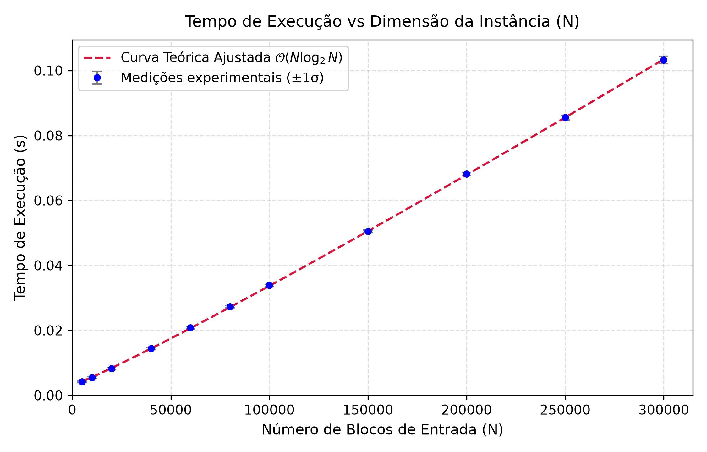
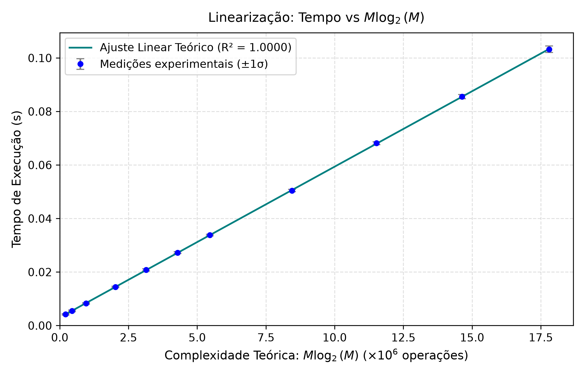

# Highest Tower Builder (3D Box Stacking)

[](https://www.rust-lang.org/)
[-blue.svg)]()
[-brightgreen.svg)]()
[]()

A high-performance, deterministic 3D Box Stacking solver written in Rust. Developed in the context of the **Analysis and Synthesis of Algorithms (ASA)** course.

This solver computes the maximum possible height of a 3D tower that can be constructed from a set of rectangular blocks subject to strict stability and orientation constraints, improving upon the classical $\mathcal{O}(N^2)$ dynamic programming approach by using coordinate compression and a 1D Fenwick Tree in **$\mathcal{O}(M \log M)$** time.

---

## Table of Contents

- [Problem Overview](#problem-overview)
- [Key Algorithmic Innovations](#key-algorithmic-innovations)
- [NASA JPL "Power of Ten" Compliance](#nasa-jpl-power-of-ten-compliance)
- [Repository Structure](#repository-structure)
- [Getting Started](#getting-started)
  - [Prerequisites](#prerequisites)
  - [Building](#building)
  - [Running](#running)
- [Input and Output Specification](#input-and-output-specification)
- [Performance & Experimental Results](#performance--experimental-results)
  - [Running the Benchmarks](#running-the-benchmarks)
- [Authors](#authors)

---

## Problem Overview

Given $N$ types of 3D rectangular blocks $(d_1, d_2, d_3)$ supplied in unlimited quantities:
1. **Unlimited Supply:** Each block type can be used as many times as needed in the tower.
2. **Rotational Freedom:** Any of the 3 faces can be chosen as the base (up to 3 canonical rotations per block type).
3. **Strict Stability Rule:** A block $(w_a, l_a, h_a)$ can be stacked on top of $(w_b, l_b, h_b)$ if and only if **both** dimensions of its base are strictly smaller:
   $$w_a < w_b \quad \land \quad l_a < l_b$$
4. **Goal:** Determine the maximum vertical tower height and reconstruct the optimal sequence of stacked blocks.

---

## Key Algorithmic Innovations

| Dimension | Classical Solution | This Implementation |
| :--- | :--- | :--- |
| **Algorithmic Model** | Longest Path in DAG | Topological Sweep-Line with Fenwick Tree |
| **Time Complexity** | $\mathcal{O}(N^2)$ | **$\mathcal{O}(M \log M)$**, where $M \le 3N$ |
| **Space Complexity** | $\mathcal{O}(N^2)$ or $\mathcal{O}(N)$ | **$\mathcal{O}(M)$** |
| **Memory Allocation** | Dynamic during DP graph | Single pre-allocation during ingestion; zero runtime allocation |

1. **Canonical Normalization ($w \le l$):** Standardizes all rotations into at most 3 non-equivalent orientations per block type using a 3-element comparison network.
2. **Dominance Pruning:** Filters identical base pairs $(w, l)$, keeping only the maximum height $h$.
3. **Coordinate Compression:** Ranks unique $l$ values, reducing the spatial coordinate range into $[1, M]$ for direct indexation into the Fenwick Tree.
4. **Range-Maximum Query (Fenwick Tree):** Replaces the inner linear scan with an $\mathcal{O}(\log M)$ prefix-maximum query to find the tallest compatible sub-tower.

For an in-depth breakdown of the invariants and algorithmic proof, see [docs/architecture.md](docs/architecture.md).

---

## NASA JPL "Power of Ten" Compliance

The core engine is engineered with extreme memory discipline and critical safety constraints inspired by NASA JPL guidelines:

- **Zero Recursion (`#![deny(unconditional_recursion)]`):** All algorithms (parsing, topological sweep, backtracking) are strictly iterative.
- **No Dynamic Memory Post-Initialization:** Buffers are pre-allocated with known bounds ($M \le 3N$); zero allocations occur inside the DP sweep.
- **Absolute Memory Safety (`#![forbid(unsafe_code)]`):** 100% safe Rust without `unsafe` blocks.
- **Defensive Error Handling (`#![deny(clippy::unwrap_used, clippy::expect_used)]`):** Panics are forbidden at compile-time; all integer operations use checked arithmetic to prevent overflow.
- **Strict Linting (`#![deny(warnings, clippy::all, clippy::pedantic)]`):** Compiles under zero-warning policy with strict pedantic lints.

---

## Repository Structure

```text
.
├── Cargo.lock
├── Cargo.toml                 # Package configuration
├── README.md                  # Project overview and documentation
├── src/
│   └── main.rs                # Core solver engine and CLI entry point
├── docs/
│   ├── architecture.md        # Technical architecture and design proof
│   ├── report.pdf             # Formal academic report
│   └── assets/                # Benchmark plots and visual assets
│       ├── plot_time_vs_n.png
│       └── plot_time_vs_theoretical.png
└── benchmarks/
    ├── benchmark_suite.py     # Multi-instance stress test harness
    ├── graph_maker.py         # Automated benchmark and plot generator
    └── conclusao_experimental.txt
```

---

## Getting Started

### Prerequisites

- [Rust Toolchain](https://www.rust-lang.org/tools/install) (version 1.85+ recommended, 2024 edition).

### Building

Compile the release binary with full optimizations:

```bash
cargo build --release
```

The compiled binary will be located at `target/release/highest-tower-builder`.

### Running

The program reads from standard input (`stdin`) and writes to standard output (`stdout`):

```bash
# Using cargo
cargo run --release < input.in

# Or directly with the compiled binary
./target/release/highest-tower-builder < input.in
```

---

## Input and Output Specification

### Input Format

* **Line 1:** An integer $N$ representing the number of available block types.
* **Next $N$ lines:** Three space-separated integers $d_1$, $d_2$, and $d_3$ defining the dimensions of each block type.

```text
4
10 20 30
15 25 35
20 30 40
25 35 45
```

### Output Format

* **Line 1:** Total maximum height $H$ followed by the number of stacked blocks $K$.
* **Next $K$ lines:** Dimensions $(w, l, h)$ of each placed block in the tower, from top to bottom.

```text
150 4
10 20 30
15 25 35
20 30 40
25 35 45
```

---

## Performance & Experimental Results

The algorithmic pipeline was benchmarked across instances ranging from $N = 5\,000$ to $N = 300\,000$ blocks, with 10 warmup executions and 100 timed runs per sample.

### Empirical Validation

| Execution Time vs. $N$ | Linearized Time vs. $M \log_2(M)$ |
| :---: | :---: |
|  |  |

* **Empirical Linearity ($R^2 = 1.0000$):** Plotting execution time against $M \log_2(M)$ (where $M \le 3N$ is the number of orientations after base deduplication) yields an exact linear fit with a coefficient of determination $R^2 = 1.0000$.
* **Asymptotic Dominance:** Experimental data demonstrates that sorting and the Fenwick Tree sweep dominate execution time, exactly mirroring the $\mathcal{O}(M \log M)$ theoretical model.

### Running the Benchmarks

To reproduce the benchmark suite and re-generate the regression plots:

```bash
# Install Python dependencies
pip install numpy matplotlib

# Execute the benchmarking and plotting harness
python3 benchmarks/graph_maker.py
```

---

## Authors

* **José Conceição** ([@JoseAfonsoCunhaConceicao](https://github.com/JoseAfonsoCunhaConceicao))
* **Tiago Santos** ([@TiagoJMSantos](https://github.com/TiagoJMSantos))

Developed for the **Análise e Síntese de Algoritmos (ASA)** course.
